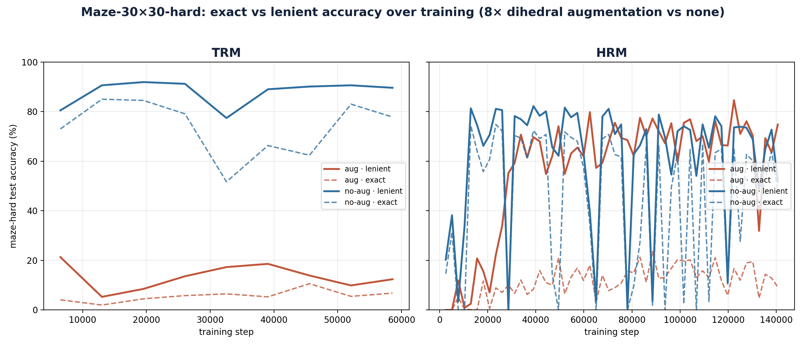

# HRM and TRM baselines

Evaluation and Maze-Hard training of **HRM**
([sapientinc/HRM](https://github.com/sapientinc/HRM)) and **TRM**
([alphaXiv/TinyRecursiveModels](https://github.com/alphaXiv/TinyRecursiveModels))
on [Modal](https://modal.com/). The upstream repos are cloned at a pinned
commit at image-build time; nothing is vendored. Which numbers the paper
reports is summarized in [`../README.md`](../README.md).

## Sudoku-Extreme: released checkpoints

The released checkpoints are evaluated on the first N puzzles (default
10,000) of LDT's `sudoku_test_perm` ordering (`ldt.eval.indices`):

```bash
uv run modal run baselines/hrm_trm/hrm_eval/modal_eval.py::sudoku            # HRM (authors' release)
uv run modal run baselines/hrm_trm/trm_eval/modal_eval.py::sudoku            # TRM-MLP (alphaXiv reproduction)
uv run modal run baselines/hrm_trm/trm_eval/modal_eval.py::sudoku --variant att
# --n 422786 evaluates the whole test split
```

Each run:
- builds the upstream test split (`test.csv` in file order, no augmentation)
  and checks it against LDT's `sudoku_extreme_test.pt` cache, index by index;
- cuts it down to the requested indices (`sudoku_rows.subset_test_split`);
- runs upstream inference on one B200 (HRM: its ACT loop; TRM:
  `scripts/run_eval_only.py` with EMA weights and bf16);
- writes per-puzzle rows (`idx`, `pos`, `status`, `solution`, the
  `ldt/eval/records.py` field names) and a summary to
  `eval/baselines/<model>/sudoku_test_perm_n<N>-<hash>/` (hash of the
  checkpoint and batch size) on the `ldt-checkpoints` volume;
- writes the summary, with a Clopper-Pearson interval and the eval time
  (`gpu_seconds`, one B200), to `baselines/hrm_trm/results/`.

TRM checkpoints need their architecture config: `trm_eval/cfg_sudoku_mlp.yaml`
(TRM-MLP) or `cfg_sudoku_att.yaml` (TRM-attention). The MLP and attention
weights have different shapes, so the wrong config fails to load.

## Maze-Hard: retrains with and without augmentation

Both models are trained on one B200 each with their published Maze-Hard
recipes (global batch 768), once with 8x dihedral augmentation and once
without. Training is bounded by Modal's 24 h function timeout. Every saved
checkpoint is then evaluated on all 1,000 test mazes:

```bash
modal secret create wandb-secret WANDB_API_KEY=<your W&B key>   # training logs to W&B
./baselines/hrm_trm/train_with_aug.sh  &&  ./baselines/hrm_trm/eval_with_aug.sh
./baselines/hrm_trm/train_no_aug.sh    &&  ./baselines/hrm_trm/eval_no_aug.sh
```

Training streams to Weights & Biases and writes `<run_name>.train.log` to the
checkpoint volume (`hrm-maze-aug-ckpts`, `trm-maze-aug-ckpts`, under
`maze-hard-repro/{hrm,trm}-maze-{aug,noaug}/`). The eval scripts write one
sweep per run to `results/` (a list of `{step, n, exact, lenient}`) and plot
them with `plot_maze_sweeps.py`. TRM is evaluated with its training loop
count (`trm_eval/cfg_maze.yaml`, `L_cycles=4`); the loop count does not
change parameter shapes, so a different value would load without error.

Each prediction is scored twice (`maze_scoring.py`):

- **exact**: the predicted grid equals the dataset's reference path, the
  single A\* shortest path;
- **lenient**: the marked path cells form a simple start-to-goal path whose
  length equals the maze's BFS shortest-path length, so any shortest path
  counts.

Best lenient accuracy over each run's checkpoints:

| Model | Training | Best lenient | Step | Exact at that step |
|---|---|---|---|---|
| HRM (27M) | with augmentation | **84.6%** | 122,388 | 16.7% |
| HRM (27M) | without augmentation | 82.2% | 39,060 | 72.4% |
| TRM (7M) | without augmentation | **91.9%** | 19,530 | 84.5% |
| TRM (7M) | with augmentation | 21.3% | 6,510 | 4.1% |

Table 3 reports the better run of each model (in bold): HRM with
augmentation, TRM without.



## Maze-Hard training throughput (one B200, global batch 768)

Steady-state step times of the Maze runs above, read off their training
progress logs. The step time does not depend on augmentation.
`modal_train.py::run_throughput` measures the Sudoku-Extreme training step
time the same way (`tqdm_rate.py`), for Table 1's compute estimates.

| Model | s / step | steps / s |
|---|---|---|
| TRM (7M) | ~1.46 | ~0.68 |
| HRM (27M) | ~0.61 | ~1.64 |
